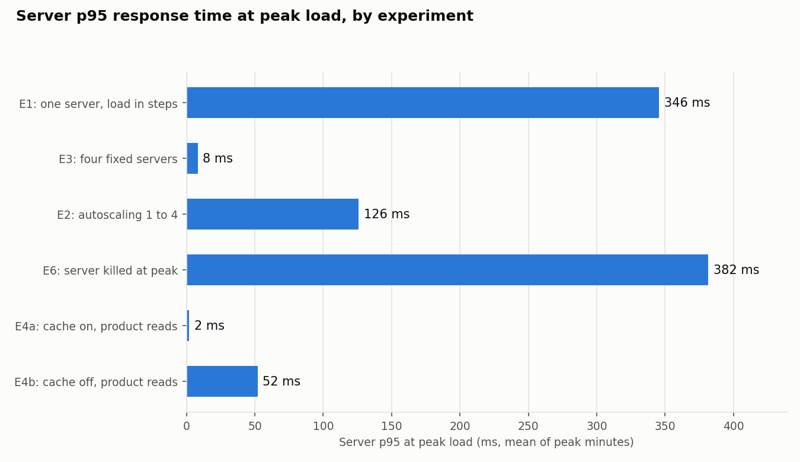

# Mini-Myntra: flash-sale scaling on AWS

[](https://github.com/Utsav-tala/mini-myntra/actions/workflows/ci.yml)

**IT457 Cloud Computing, Group 9** · Case study: *Myntra, cloud-based personalization and flash-sale scaling* (Scalability theme)

A cloud proof of concept of Myntra's sale-day problem. A small Node.js shopping API runs on EC2 behind an Application Load Balancer; an Auto Scaling Group adds servers when a flash-sale spike pushes average CPU above 50% and removes them afterwards. Redis on ElastiCache is the shared cache. Everything is built by GitHub Actions, created with one command (CloudFormation), and was load-tested with k6.

**Final report:** [docs/FINAL-REPORT.pdf](docs/FINAL-REPORT.pdf) · **Results:** [docs/results/comparison/README.md](docs/results/comparison/README.md) · **Runbook:** [docs/RUNBOOK.md](docs/RUNBOOK.md)

---

## Key results

| Question | Answer |
| --- | --- |
| How much can one server take? | Healthy to 350 shoppers (641 req/s); saturates near **670 req/s** (E1) |
| Does autoscaling handle a sale spike? | Yes: 1 → 4 servers, server p95 **326 ms → 9 ms**, 27 of 771,896 requests failed (E2) |
| How fast does it react? | About **4–6 minutes** from spike to full capacity |
| Four always-on servers? | p95 **8 ms**, 0 failures, but about 43% more cost per day (E3) |
| Server crash at the peak? | 0.51% errors for ~1 minute; replacement in **61 s**; recovered by itself (E6) |
| Redis cache? | Product reads **2 ms vs 52 ms** without it, 26x faster (E4) |



**Conclusion:** autoscaling works and saves cost, but reacts a few minutes late; for a sale with a known start time, add capacity just before it opens.

---

## Architecture

```
Shoppers / k6 load generator
            │ HTTP
            ▼
Application Load Balancer ── health check /health every 10 s
            │
            ▼
Auto Scaling Group: 1–4 × t3.micro (ap-south-1a, 1b), target tracking CPU 50%
   each server: Docker → Node.js API (one worker per vCPU)
            │
            ▼
ElastiCache Redis: product cache + flash-sale stock

CloudWatch: metrics, alarms, dashboard          GitHub Actions → Docker Hub image
CloudFormation: 7 stacks, deploy.sh / teardown.sh
```

| Cloud concept | Where it is used |
| --- | --- |
| Elasticity / horizontal scaling | Auto Scaling Group 1–4 servers |
| Load balancing + health checks | Application Load Balancer, `/health` |
| Target tracking + monitoring | CloudWatch CPU alarm at 50% |
| Stateless servers + caching | Shared Redis (cache-aside, atomic stock) |
| High availability | Two Availability Zones in Mumbai |
| Infrastructure as Code | CloudFormation templates in `infra/templates/` |
| Containers + CI/CD | Docker image built and tested by GitHub Actions |
| Least-privilege security | Security groups: internet → ALB → app → Redis |
| Cost control | $20 budget alarm, teardown after every session |

---

## Repository layout

| Folder | Contents |
| --- | --- |
| [`app/`](app/README.md) | Node.js API (endpoints, Redis cache, flash-sale checkout), Dockerfile, 32 tests |
| [`infra/`](infra/README.md) | CloudFormation templates, server boot script, `deploy.sh` / `teardown.sh` |
| [`loadtest/`](loadtest/README.md) | k6 flash-sale script, experiment profiles E1–E6, `run.sh` |
| [`analysis/`](analysis/README.md) | Scripts that merge k6 and CloudWatch data and draw the graphs |
| [`docs/`](docs/README.md) | Final report, runbook, results of every experiment, screenshots |
| `.github/workflows/` | CI: test, build, push the Docker image |

---

## Quick start

**Run locally** (Docker, no AWS needed):

```bash
docker compose up --build
```

Open http://localhost:3000.

**Run the tests:**

```bash
cd app && npm ci && npm test
```

**Deploy to AWS** (AWS CLI logged in, region ap-south-1; about 15 minutes):

```bash
bash infra/deploy.sh
```

It prints `Live: http://...`. Open it with `http://` (not https).

**Load test** (example, from a machine with k6):

```bash
bash loadtest/run.sh E2 http://<load-balancer-url>
```

**Tear down** (always, when done; the idle stack costs about $0.08/hour):

```bash
bash infra/teardown.sh
```

Full steps: [docs/RUNBOOK.md](docs/RUNBOOK.md) and [loadtest/RUN-ON-AWS.md](loadtest/RUN-ON-AWS.md).

---

## Experiments

| ID | Question | Result | Details |
| --- | --- | --- | --- |
| P2 | First autoscaling check | 1 → 4 servers, p95 157 → 37 ms | [results](docs/results/P2-scaling-check/README.md) |
| E1 | One server's breaking point | Saturates at ~670 req/s | [results](docs/results/E1/) |
| E3 | Four fixed servers | p95 8 ms, 0 failures | [results](docs/results/E3/) |
| E2 | Autoscaling during a sale | p95 326 → 9 ms, 27 failed | [results](docs/results/E2/) |
| E6 | Server killed at the peak | 0.51% errors, recovered in ~90 s | [results](docs/results/E6/) |
| E4 | Cache on vs off | 2 ms vs 52 ms | [on](docs/results/E4-cache-on/), [off](docs/results/E4-cache-off/) |

E5 (scheduled scale-out before the sale) was planned but not run; E2 already measures the delay it would remove.

---

## Live demo

The stack is torn down between sessions to save credits, and each deployment gets a new load balancer address. After `bash infra/deploy.sh`, print the current URL with:

```bash
aws cloudformation describe-stacks --region ap-south-1 --stack-name mini-myntra-app --query "Stacks[0].Outputs[?OutputKey=='LoadBalancerUrl'].OutputValue" --output text
```

---

## Team

| Member | Built | Experiments |
| --- | --- | --- |
| Utsav Tala (202303018) | Repository, CI, security groups, load balancer + Auto Scaling Group, deploy/teardown, budget, home page, runbook, Node.js cluster fix | E2, comparison |
| Rom Tala (202303051) | Node.js API, Redis integration, Dockerfile, server boot script, Redis template | E4, E6 |
| Chaitri Vadaviya (202301243) | Tests, k6 script, CloudWatch dashboard, load generator and profiles, analysis script | E1, E3, Phase 2 results |

Built on AWS ap-south-1 (Mumbai) with new-account credits; total cost of the whole project was a few dollars.
