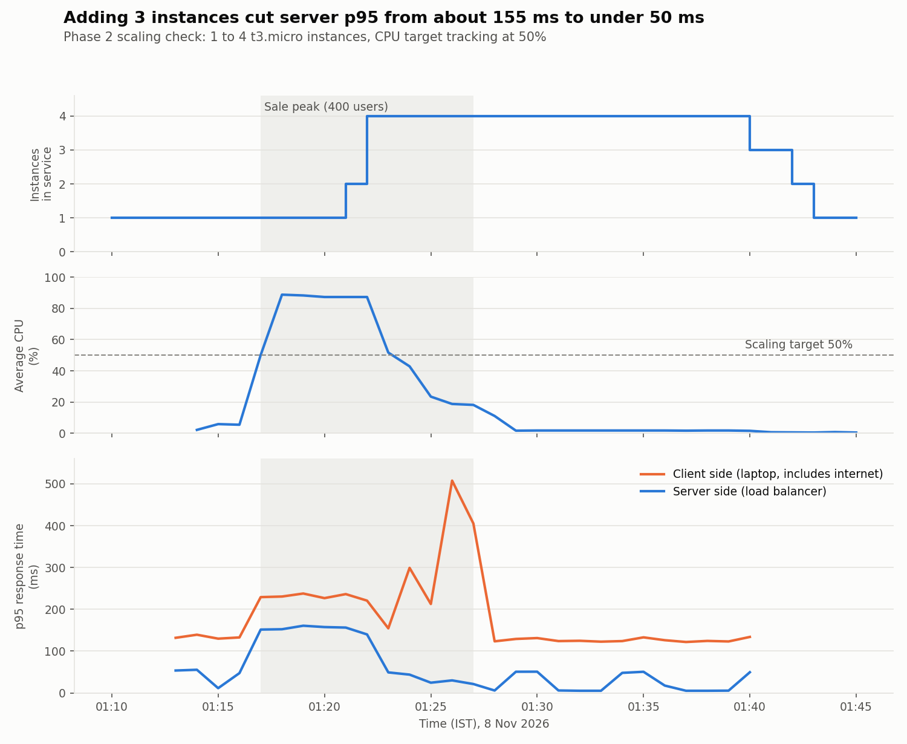
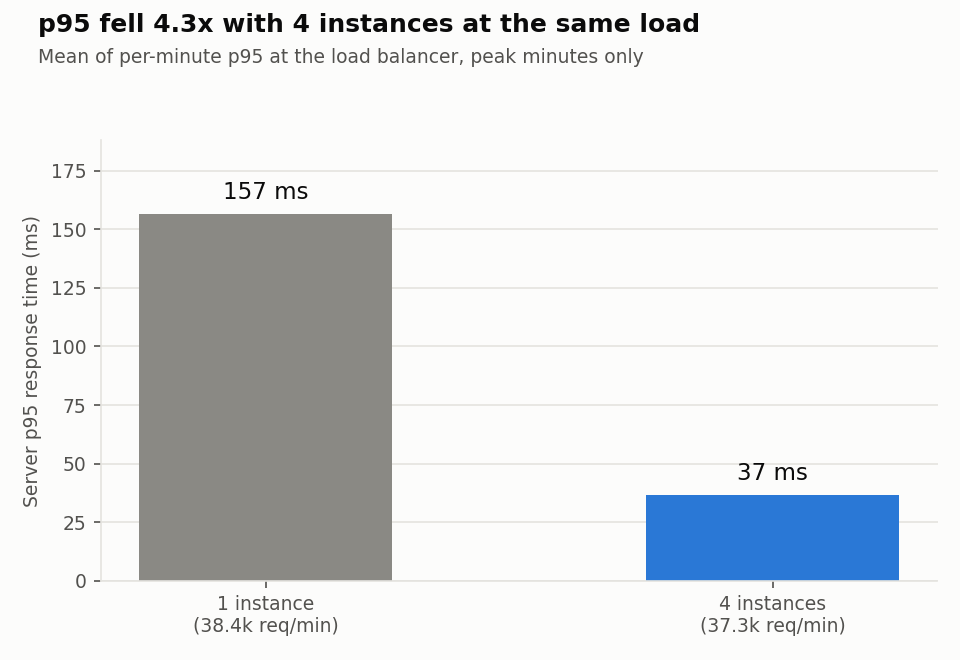

# Phase 2 scaling check (8 Nov 2026)

The Auto Scaling Group grew from 1 to 4 t3.micro instances within about 5 minutes of the sale opening, and server-side p95 response time fell from **157 ms to 37 ms** at the same load (about 38,000 requests per minute). It scaled back to 1 instance about 12 minutes after the load dropped.

## Setup

| Item | Value |
| --- | --- |
| Region | ap-south-1 (Mumbai), zones 1a and 1b |
| Instances | t3.micro (2 vCPU), 1 to 4, one Node.js worker per vCPU |
| Scaling rule | Target tracking, average CPU 50% |
| Load | k6 2.3.0 from a laptop over home internet, `sale` shape: 20 users warm-up, ramp to 400 in 1 minute, hold 10 minutes, ramp down, 12 minutes quiet |
| Request mix | 50% product, 35% recommendations (CPU-heavy), 15% checkout |
| Run by | Chaitri Vadaviya (k6), Utsav Tala (AWS and screenshots) |

## Results

| Phase (IST) | Instances | Avg CPU | Server p95 | Requests/min |
| --- | --- | --- | --- | --- |
| Peak, before scale-out (01:18–01:21) | 1 | 87–89% | 152–161 ms | ~38,400 |
| Peak, after scale-out (01:23–01:26) | 4 | 19–52% | 24–49 ms | ~37,300 |
| Quiet (01:29–01:39) | 4 | ~2% | 5–51 ms | ~2,100 |

Scaling events (from the Auto Scaling activity log):

| Time (IST) | Event | Trigger |
| --- | --- | --- |
| 01:17 | CPU passes 50% | Sale ramp |
| 01:20:53 | 1 → 2 instances | High-CPU alarm (3 minutes above target) |
| 01:22:51 | 2 → 4 instances | High-CPU alarm still firing |
| 01:22:27 / 01:24:26 | New instances in service | about 1.5 minutes from launch |
| 01:28 | Load drops | End of hold |
| 01:40:57, 01:42:35, 01:43:35 | 4 → 3 → 2 → 1 | Low-CPU alarm (scale-in waits longer than scale-out) |

Totals (k6): 448,808 requests, 282 per second on average, **7 failed (0.0016%)**, all HTTP 502 from the load balancer between 01:18 and 01:21, while the single instance was saturated. None failed after the extra instances arrived.

## Notes for the report

- Client-side p95 (from the laptop) is about 75–100 ms higher than server-side throughout, because it includes the internet round trip (idle p50 was about 49 ms). Its spike at 01:24–01:27 (up to 508 ms) did not appear at the load balancer (server p95 21–44 ms), so it came from the laptop or home network, not AWS. Use the server-side numbers for scaling conclusions.
- Scale-out took about 5 minutes from CPU passing 50% to 4 instances: about 3 minutes for the alarm (three 1-minute datapoints) plus about 1.5 minutes per instance to boot and pass health checks. Experiment E5 (scheduled scale-out before a known sale) targets this gap.
- Before this run the API used a single Node.js process. On a 2-vCPU instance that caps CPU near 50%, right at the scaling target, so the app now runs one worker per vCPU (commit `perf(app): run one Node worker per vCPU`). A local 2-CPU test showed 631 vs 384 requests per second. See `../P2-baseline-1worker/`.

## Files

| File | What it is |
| --- | --- |
| `k6-summary.json` | k6 end-of-test summary (all percentiles) |
| `k6-per-minute.csv` | Client-side requests and p50/p95/p99 per minute |
| `cloudwatch-per-minute.csv` | Server-side CPU, instances, requests, p95/avg response time, healthy hosts, 5xx per minute |
| `cloudwatch-raw.json` | Raw CloudWatch `get-metric-data` output |
| `instances.csv` | Desired and in-service instance counts every 15 s (times in UTC; IST = UTC + 5:30) |
| `scaling-timeline.png`, `p95-vs-instances.png` | Graphs, made by `analysis/plot_scaling_check.py` |
