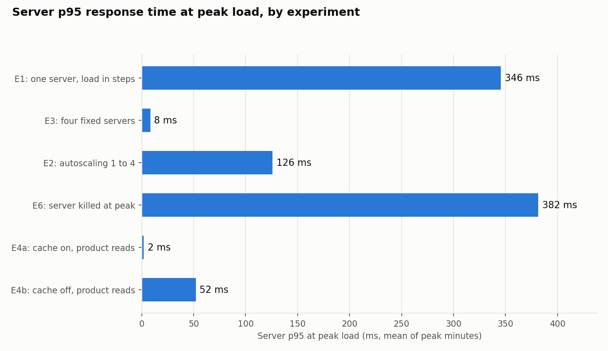

# Phase 3 results: what the experiments show

Runs on 14–15 Nov 2026 in ap-south-1. Load from a t3.medium k6 load generator in the same region; app servers are t3.micro (2 vCPU, one Node.js worker per vCPU) behind an Application Load Balancer, Redis on ElastiCache. Server-side numbers are the load balancer's `TargetResponseTime`. Full table: [comparison.md](comparison.md).

## Findings

1. **One server saturates near 670 requests/second (E1).** Throughput grows in step with users up to 350 users (641 req/s, p95 114 ms, CPU 89%). Past that CPU sits at 97–100% and extra users only queue: at 500 users p95 is 399 ms for the same ~670 req/s. This set the peak load for the sale experiments at 500 users.
2. **Four warm servers absorb the whole sale (E3).** At 500 users: 989 req/s, server p95 8 ms, CPU about 29%, 0 of 824,699 requests failed. Cost: about $0.134 per hour, all the time.
3. **Autoscaling gets there, but late (E2).** CPU passed 50% when the sale opened; the group went 1 → 2 servers about 3.5 minutes later and 2 → 4 two minutes after that. Server p95 was **326 ms in the first peak minutes and 9 ms by the end of the peak**. 27 of 771,896 requests failed, all during the one-server minutes. The group scaled back to 1 server 11–17 minutes after the load dropped (scale-in is deliberately slower than scale-out). Average capacity at peak was 3.1 servers, about $0.116 per hour, and it falls back to 1 server ($0.074 per hour) when traffic is low.
4. **A server crash during scale-out hurts, but the system heals itself (E6).** One server was terminated at 11:53:54 UTC while the group showed 4 servers in service, but only 2 had passed load balancer health checks. For about one minute a single healthy server carried all traffic: 2,067 of 401,442 requests failed (0.51%, HTTP 502/504). The Auto Scaling group launched a replacement 61 s after the kill ("unhealthy instance needing to be replaced"), and by the next minute p95 was back to 31 ms with no failures. No restart or manual fix was needed, and there was no cascade.
5. **The cache cuts product-read latency 26x (E4).** Same load (50 users, product reads only, 1 server): p95 **2 ms with Redis** against **52 ms from the slow store** (simulated 50 ms database), and 246 vs 198 req/s.

## What this means for a sale like Myntra's

- Reactive autoscaling alone leaves the first 4–6 minutes of a flash sale on too little capacity: the alarm needs three 1-minute datapoints above target, then each new server needs about 1.5 minutes to boot and pass health checks.
- Because sale times are known in advance, capacity should be added before the sale opens (scheduled scaling or a raised minimum), with target tracking handling anything beyond the forecast. E3 shows what warm capacity buys: flat 8 ms p95 and no failures.
- "InService" in the Auto Scaling group is not the same as "receiving traffic": a failure in that gap concentrates load on the remaining healthy servers (E6). Spare headroom (more than one healthy server at all times) protects against it.
- A cache-first read path, as in Myntra's pricing system, is the cheapest latency win: one Redis node turned a 52 ms read into a 2 ms one.

## Notes on method

- **E5 (scheduled scale-out) was not run.** E2 already measures the scale-out delay that E5 targets; scheduled scaling is described above as the recommended fix.
- **E6 used a shortened profile** (8-minute hold, 3-minute cool-down). The server was terminated by script once 3 or more servers were in service; see `../E6/termination.txt`.
- **E2 used the full profile** (12-minute hold, 15-minute cool-down) so scale-in could be observed.
- **E4b's table shows "max instances 2"** because the instance refresh that switched the cache off overlapped the first minutes of the window; the test itself ran on 1 server.
- The first E1 attempt (14 Nov) was discarded: the t3.small load generator froze after about 14 minutes and the group was not limited to 1 server. All load generation after that used a t3.medium with a raised open-file limit.
- Costs are estimates from on-demand ap-south-1 prices (EC2, load balancer, Redis, public IPv4, monitoring, EBS), excluding load balancer capacity units and CPU-credit surcharges. The whole of Phase 3 cost well under $1 of the account's credits.
